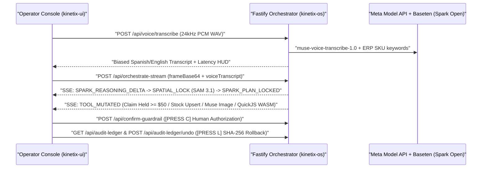

# KINETIX OS — Tactical Spatial ERP Console (`kinetix-ui`)

**Meta Global AI Developer Hackathon** | **Track:** Indie Developer | **Pillar:** *Push the Frontier*  
**Backend Orchestrator Repository:** [Gabyresina15/kinetix-os](https://github.com/Gabyresina15/kinetix-os)

Tactical React 19 + TypeScript + Tailwind v4 operator console for **KINETIX OS**. Connects all **5 live Meta AI runtime models**:
1. **Muse Voice Transcribe (`muse-voice-transcribe-1.0`)** — Web Audio API `24 kHz` mono 16-bit PCM WAV capture with dynamic ERP SKU vocabulary biasing.
2. **Muse Spark Open (`meta-models/muse-spark-open-1026` on Baseten)** — Real-time SSE multimodal spatial grounding & multi-tool DAG planning.
3. **SAM 3.1 (`sam-3.1`)** — Letterbox-exact 2D pixel bounding-box refinement.
4. **Muse Image 1.0 (`muse-image-1.0`)** — Before/After Crop-to-Studio catalog synthesis with Visual-DNA badges.
5. **Muse Wonder 1.0 (`muse-wonder-1.0`)** — Commercial pricing policy synthesis executed inside **QuickJS WebAssembly** (`quickjs-wasm`).

---

## 1. Real-Time SSE & Cryptographic Control Flow



---

## 2. Key Tactical Console Capabilities

- **Web Audio `24 kHz` PCM Recorder for Muse Voice Transcribe:** Captures mono Float32 microphone audio, resamples via `OfflineAudioContext` to native `24,000 Hz` 16-bit signed PCM RIFF/WAVE, and dispatches to `POST /api/voice/transcribe` with live ERP catalog vocabulary biasing.
- **Letterbox-Exact 2D Bounding Box Overlay:** Computes exact rendered media bounds (`ResizeObserver`) so normalized `[xMin, yMin, width, height]` masks from **Muse Spark Open** + **SAM 3.1** stay pixel-locked across any aspect ratio or window resize.
- **Cryptographic SHA-256 Audit Ledger & 1-Click Compensating Undo (`[PRESS L]`):** Slide-over hash-chain inspector verifying `prevHash -> txHash` integrity across every stock upsert, WASM reprice, and supplier claim, with 1-click `[UNDO TX]` atomic rollback.
- **Interactive Supervisor Triage Popover:** Clicking any spatial mask opens a contextual inspection popover with persisted `POST /api/triage/resolve` actions (`CONFIRM STOCK` or `QUARANTINE & OPEN CLAIM`).
- **Zero-Trust `$50` Financial Guardrail (`[PRESS C]`):** Holds any supplier debit `>= $50.00 USD` in amber quarantine until explicit operator confirmation triggers `POST /api/confirm-guardrail` (Telegram photo dispatch + MongoDB audit).
- **QuickJS WASM Policy Inspector:** Displays the exact JavaScript pricing function synthesized by **Muse Wonder 1.0**, the evaluated output price, WASM engine status (`quickjs-wasm`), and pre-commit financial invariant verification (`PASS`/`FAIL`).

---

## 3. Quickstart (60 Seconds with Deterministic Replay)

1. Start the backend orchestrator ([`kinetix-os`](https://github.com/Gabyresina15/kinetix-os)) in zero-key `REPLAY` mode (or `LIVE` mode with API keys):
   ```bash
   git clone https://github.com/Gabyresina15/kinetix-os.git
   cd kinetix-os
   npm install
   npm run replay
   ```
2. In a second terminal, launch `kinetix-ui`:
   ```bash
   git clone https://github.com/Gabyresina15/kinetix-ui.git
   cd kinetix-ui
   npm install
   npm run dev
   ```
3. Open `http://localhost:5173`:
   - Click **`MIC`** to record a spoken Spanish/English directive via **Muse Voice Transcribe 1.0** (or use the preloaded multi-intent benchmark prompt).
   - Press **`SPACE`** (or click **RUN SPATIAL ORCHESTRATION**) to execute the spatial DAG.
   - Press **`C`** (or click **AUTHORIZE & DISPATCH CLAIM**) to approve the held `$65.00` supplier claim.
   - Press **`L`** (or click **`[L] LEDGER`**) to inspect the SHA-256 hash chain and test **`UNDO TX`** atomic rollback.
   - Click any bounding box on the workbench stage to test **Supervisor Triage**.
   - Press **`R`** to reset the 31-SKU canonical catalog state.

### Environment Variables

Copy `.env.example` to `.env` if pointing to a remote backend URL:

```env
VITE_API_URL=http://localhost:4000
```

---

## 4. Hackathon Timeline & Disclosure

- **Hackathon Window:** Built for the Meta Global AI Developer Hackathon (October 27 – November 4, 2026).
- **Timestamp Note:** Initial Vite + React repository scaffolding was initialized on the evening of October 26 (~21:00 ART / UTC-3); all spatial overlay math, Muse Voice 24 kHz WAV recorder, SSE streaming hooks, DAG telemetry components, SHA-256 audit drawer, supervisor triage workflows, and guardrail UI were built during the official hackathon window.
- **License:** [MIT](./LICENSE)
