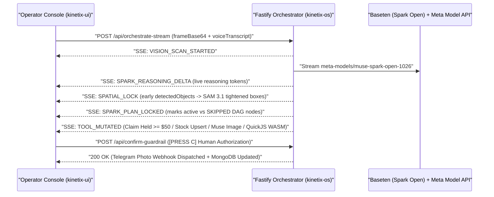

# KINETIX OS — Tactical Spatial ERP Console (`kinetix-ui`)

**Meta Global AI Developer Hackathon** | **Track:** Indie Developer | **Pillar:** *Push the Frontier*  
**Backend Orchestrator Repository:** [Gabyresina15/kinetix-os](https://github.com/Gabyresina15/kinetix-os)

Tactical React 19 + TypeScript + Tailwind v4 operator console for **KINETIX OS**. Renders real-time 2D spatial bounding boxes refined by **SAM 3.1**, live SSE reasoning telemetry from **Muse Spark Open (`meta-models/muse-spark-open-1026` on Baseten)**, interactive supervisor SKU triage, **Muse Image 1.0** Crop-to-Studio asset comparisons, **Muse Wonder 1.0** policy synthesis executed inside **QuickJS WebAssembly**, and human-in-the-loop **$50 USD Zero-Trust Guardrail** authorization.

---

## 1. Real-Time SSE UI State Machine



---

## 2. Key Tactical Console Capabilities

- **Letterbox-Exact 2D Bounding Box Overlay:** Computes exact `object-contain` rendered media bounds (`ResizeObserver`) so normalized `[xMin, yMin, width, height]` masks from **Muse Spark Open** + **SAM 3.1** stay pixel-locked across any aspect ratio or window resize.
- **Interactive Supervisor Triage Popover:** Clicking any spatial mask opens a contextual inspection popover displaying real Sharp crop evidence, 2D region coordinates, confidence, and persisted `POST /api/triage/resolve` actions (`CONFIRM STOCK` or `OPEN DEFECT CLAIM`).
- **Live Streaming DAG & Spark Trace:** Consumes `SPARK_REASONING_DELTA`, `SPARK_PLAN_LOCKED`, `TOOL_MUTATED`, and `TOOL_FAILED` over `fetch` ReadableStream SSE with `AbortController` (`[ESC]` aborts in-flight orchestration cleanly).
- **Zero-Trust `$50` Financial Guardrail (`[PRESS C]`):** Holds any supplier debit `>= $50.00 USD` in amber quarantine until explicit operator confirmation triggers `POST /api/confirm-guardrail`.
- **QuickJS WASM Policy Inspector:** Displays the exact JavaScript pricing function synthesized by **Muse Wonder 1.0**, the evaluated output price, WASM engine status (`quickjs-wasm`), and pre-commit financial invariant verification (`PASS`/`FAIL`).

---

## 3. Quickstart (60 Seconds with Deterministic Replay)

1. Start the backend orchestrator ([`kinetix-os`](https://github.com/Gabyresina15/kinetix-os)) in zero-key `REPLAY` mode (or `LIVE` mode with API keys):
   ```bash
   git clone https://github.com/Gabyresina15/kinetix-os.git
   cd kinetix-os
   npm install
   npm run replay
   ```
2. In a second terminal, launch `kinetix-ui`:
   ```bash
   git clone https://github.com/Gabyresina15/kinetix-ui.git
   cd kinetix-ui
   npm install
   npm run dev
   ```
3. Open `http://localhost:5173`:
   - Press **`SPACE`** (or click **RUN SPATIAL ORCHESTRATION**) to execute the spatial DAG.
   - Press **`C`** (or click **AUTHORIZE & DISPATCH CLAIM**) to approve the held `$65.00` supplier claim.
   - Click any bounding box on the workbench stage to test **Supervisor Triage**.
   - Press **`R`** to reset the 31-SKU canonical catalog state.

### Environment Variables

Copy `.env.example` to `.env` if pointing to a remote backend URL:

```env
VITE_API_URL=http://localhost:4000
```

---

## 4. Hackathon Timeline & Disclosure

- **Hackathon Window:** Built for the Meta Global AI Developer Hackathon (October 27 – November 4, 2026).
- **Timestamp Note:** Initial Vite + React repository scaffolding was initialized on the evening of October 26 (~21:00 ART / UTC-3); all spatial overlay math, SSE streaming hooks, DAG telemetry components, supervisor triage workflows, and guardrail UI were built during the official hackathon window.
- **License:** [MIT](./LICENSE)
